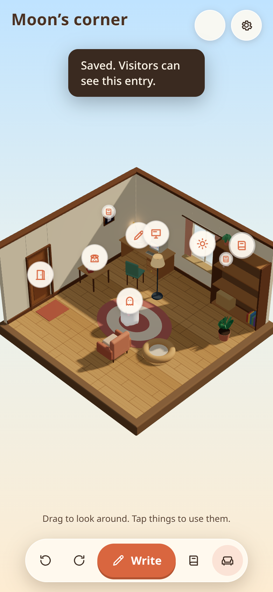
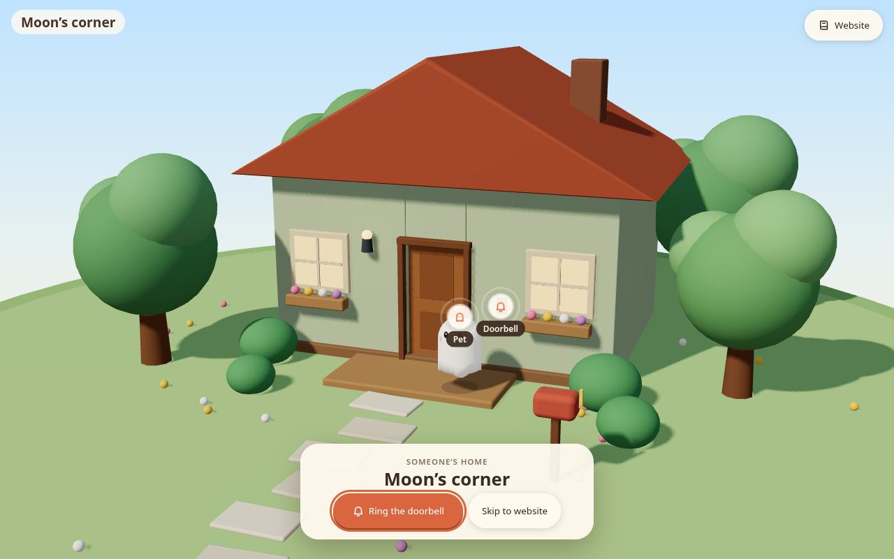
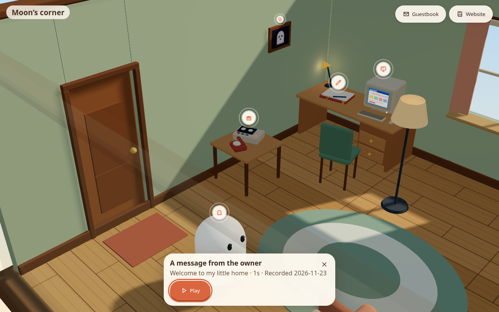

# Little Internet

**Your world, your web.** A small 3D home that remembers your life, and a personal website you can take with you.

Kiroween 2026, **Resurrection** category. What it brings back is the GeoCities-era personal homepage (a plot of
the web you decorate and own, friend links, a guestbook) and the answering machine. What is new is a lit 3D room
in the browser, memories that become objects, and a site you can export and keep running without us.



## How it works

You open the app and you are in your house, with a pet. Things in the room are real:

| In the room | What it does |
|---|---|
| Diary on the desk | Write an entry (private by default). Optionally pick a keepsake for it. |
| Keepsakes (shell, candle, photo frame, cassette, ...) | Objects **you** choose for an entry. Tap one to reopen the entry. |
| Computer | Your website: preview as a visitor, publish, download, friends, webring, guestbook inbox. |
| Answering machine | Record or choose your own voice. Mark one as the welcome message. |
| Pet | Remembers what you wrote ("on this day", "when did I last write about..."), on your device only. |
| Window | Day, night, or follow your clock. |
| Front door | Preview what a visitor sees. |

The same entries also live in a plain **Journal** list (search, visibility), because writing should not need
hunting for a desk. One data model, three views: Home (3D), Journal (list), Web (generated site).

**Decorate**: house style (cabin or villa), wall colour, floor, light, furniture on a 6x6 floor, undo.
**English and Chinese**, switchable at any time.

### A visitor's first minute

Open a published link. You are standing outside the house, at night or in daylight. Ring the doorbell, the door
opens, the pet runs to greet you, you step in. The owner's welcome message is **offered, never autoplayed**.
Tap a keepsake to read the public entry it belongs to. Leave a note in the guestbook; the owner reads it first.
Without JavaScript or WebGL the same page is a normal static website. "Skip to website" is always there.




## Principles (enforced by tests)

- **Private by default.** Every entry, recording and keepsake starts private. Nothing rewards publishing.
- **Private content never leaves the device.** The server only ever receives the public-projection site ZIP.
  Property tests plant marker strings in private entries and check no exported file contains them.
- **Take it with you.** Edit, Publish, Export, Run independently on another host, Re-import. This chain is checked
  end to end in a real browser. Exports include the 3D room runtime (`room.js`, no CDN, no platform URL).
- **No generated content from your text.** You pick the keepsake. The app never reads private text to decide.

## Run it

```bash
npm install
npm run build                # builds the visitor runtime, typechecks, builds the app
npm run server               # app + publishing + guestbook on http://localhost:8787
npm run dev                  # Vite dev server (publishing needs the server; set its address in the Computer panel)
npm test                     # 88 unit and property tests, including the server
npm run e2e                  # builds, starts server + a plain static host, drives headless Chromium (56 checks)
                             # first time: npx playwright install chromium-headless-shell
```

Server settings (environment): `PORT`, `DATA_DIR`, `APP_DIR`, `HOST`, `TRUST_PROXY=1` behind a proxy.
Needs Node 22.18+ (runs TypeScript directly, uses `node:sqlite`).

### Backend

`server/index.ts`: serves published sites at `/@slug/`, stores guestbook notes.
A slug is claimed by the first publisher's key (created in the browser, never in a backup; the server keeps only
its SHA-256). Uploads are validated (paths, extensions, sizes, matching `site.json`). Guestbook notes are plain text,
length limited, rate limited, and **pending until the owner approves them**.

## 3D models (Blender)

Every object in the room, the pet and both houses are low-poly models built in **Blender 5 from code**
(`assets/blender/build_props.py`, 59 models, reviewed in `assets/review/`). 42 of them form the kit the app uses:
they are quantized (about 950 KB) and embedded in the app and in the exported `room.js`, so a published site still needs
no CDN. Hotspots come from `hs_*` empties in the models, the computer screen shows a small homepage, lit materials
(`emissive_*`) follow day and night, and the pet ghost plays its three clips (idle, move, sleep).

If a model is missing, the app falls back to the same objects drawn in code (`src/room3d/builders.ts`).

**Cost:** the visitor runtime `room.js` is about 2.1 MB (about 630 KB gzipped): three.js plus the models.

### Hunyuan3D-2 (experiment, not shipped)

`scripts/assets/` can turn a reference picture into a mesh with the public Hunyuan3D-2 Space (shape only; its
text-to-3D and texture stages are off) and simplify it. It produced a bookcase (`assets/hunyuan/bookcase.glb`), but the
app now uses the Blender version, so **no AI-generated model ships**. Hunyuan3D-2's license excludes the EU, UK and
South Korea; check it before reusing that file.

## Layout

```
src/core/       pure TypeScript: schema, room rules, privacy projection, generator, ZIP, RSS
src/room3d/     Three.js room, exterior, pet, props (shared by the app and the visitor runtime)
src/runtime/    ghost.js and room-entry.ts (built to room.bundle.js, shipped in exports as room.js)
src/editor/     the app: commands, store, i18n, UI
server/         publishing and guestbook
scripts/        e2e, asset pipeline, dev screenshots
.kiro/          steering (product, tech, security) and specs, including specs/room3d
docs/kiro-log.md  what happened while building, including what did not work
```

## Known limits

- Phone browsers differ in WebGL speed. "Simple view" (Settings) swaps the 3D room for the same objects as cards.
- Guestbook works only on the platform copy; exported copies on other hosts hide it by design.
- Furniture is a small set (7 decor kinds, 8 keepsake kinds, 2 house styles). No shop, no forum, no town.
- Ambient occlusion is not baked into the models yet, so the live room looks flatter than the Cycles renders.
- Chinese strings were written without a native review.
- Embedded videos and friend links point to other sites and can change after export.

## License

MIT, see [LICENSE](./LICENSE).
