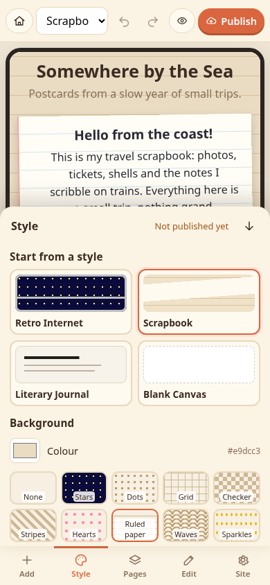

# Little Internet

**The internet used to feel like a place. Let's make it feel like home again.**
Build a home. Build a website. Build your own little internet.

Kiroween 2026, **Resurrection** category. What comes back is the **GeoCities-era personal homepage**: a plot of
the web you decorate by hand and own, with a guestbook, friend links, 88×31 badges and a **webring** you walk without
an algorithm. What is new: a lit 3D room in the browser, a visual website editor (not a template picker), life entries
that can become objects on a shelf, private-by-default publishing, and a site you can export and run without us.




## Try it in one minute

Open the app. No account. The first screen is a **cover, not a form**: a painted field of little homes, the story of
what this place is, and one door. Push it open and a four-chapter **moving-in journal** asks for a name, a room, a
companion and a kind of paper, while the 3D room changes behind the page. When you move in, a pinned **Day One**
postcard offers three real things to do: write the first page, arrange one object, open the door and publish.

If you only want to look around, the cover also leads to **three published demo homes** (fictional owners, each a
different style). A demo becomes your own private copy to decorate, write in, publish and export. A copy lives on
your device and has a different address, so it can never overwrite the public demos.

| Demo home | Owner (fictional) | Website | Room |
|---|---|---|---|
| The Book Nook | a reader who keeps notes | Literary: serif, long reading, bookshelf | sage walls, walnut floor, bookcase |
| Somewhere by the Sea | a slow traveller | Scrapbook: paper, tape, polaroids, postcards | villa, sky walls, daylight |
| The Midnight Internet | a hobbyist who hand-makes a homepage | Retro: tiled sky, window frames, badges, guestbook, webring | plum walls, checker floor, night |

They are ordinary projects built with the same data model, editor, publisher and renderer as yours.

## One world, three views, two ateliers

- **Home** (3D room): tap the diary, the answering machine, the shelf, the door, the computer.
- **Journal**: the same entries as a plain, searchable list.
- **Web**: your public website, generated from the same entries.
- **Home Atelier** decorates the room. **Web Atelier** decorates the website: add, remove, drag to reorder and resize
  components (Welcome, About, Diary, Photo gallery, Bookshelf, Memory collection, Audio welcome, Boo, Guestbook,
  Cool links, Webring, 88×31 badge, Text, Image/GIF, Stickers, Dividers, Under construction); change background colour,
  tiled patterns or an uploaded image, fonts, colours, borders, corners, shadows; add pages; set favicon and a
  scrolling welcome banner; undo/redo; desktop and phone preview; save a draft; publish when ready.
- Layout is a responsive column grid (not free absolute positioning), so a site cannot overflow a phone screen.
- Starter styles are only starting points: Retro Internet, Scrapbook, Literary Journal, Blank Canvas.

## Neighbours without an algorithm

Join the **webring** on purpose. **Prev / Next / Random** link real published homes in join order (`/ring/`), with no
ranking and no recommendations. Make your own **88×31 badge** (real PNG, copyable HTML). Saving a neighbour's badge is
one-way: it does not follow anyone and grants no access.

## Privacy and ownership

- **Private by default.** Every entry, recording and keepsake starts private. Publishing is always an explicit act.
- **Draft vs published.** Editing never changes what visitors see until you press Publish. Hidden components are never
  published. A diary component only ever shows entries that are public.
- **Close the Door.** Deletes the published copy from the server: page, media, RSS, guestbook and webring entry. It
  cannot recall copies others already downloaded, and the app says so.
- **Move my home.** Website ZIP (HTML, CSS, JS, RSS, public media, 3D room runtime; opens offline and on any static host),
  and a private backup of everything (never upload it). The public 3D home is part of the website ZIP; a separate
  3D-only package is **not built**.
- Published pages are served in a CSP `sandbox`, so a user's site cannot read the editor's data or keys.
- No user-written HTML, JavaScript or iframes (video embeds are limited to YouTube/Vimeo ids).

## Run it

```bash
npm install
npm run build              # visitor runtime, typecheck, app
npm run server             # app + publishing + webring on http://localhost:8787 (Node 22.18+)
SERVER=http://localhost:8787 KEYS=./data/demo-keys.json node scripts/seed-demo.mjs   # publish the 3 demo homes
npm test                   # unit + property tests
npm run e2e:atelier        # builds, starts the server and a plain static host, drives headless Chromium
                           # first time: npx playwright install chromium
BROWSER=webkit BASE=http://localhost:8787 node scripts/e2e-browser.mjs   # cross-browser smoke (WebKit/Firefox/Chromium)
BASE=https://your.host node scripts/live-check.mjs                       # acceptance check of a deployment
```

Deploying to a server: [deploy/README.md](deploy/README.md) (status: written, not yet built in Docker).

## Status (honest)

| Area | State |
|---|---|
| Tests | 210 unit and property tests; 45 Web Atelier end-to-end checks; 16 two-profile Heart Mail checks; 7 public-gift checks; 10 fake-camera checks (all headless Chromium); 17-check cross-browser smoke (Chromium). V5 status per area: [docs/v5/REPORT.md](docs/v5/REPORT.md) |
| Safari / WebKit | **Not tested**: the WebKit build cannot start in the dev sandbox. Run `scripts/e2e-browser.mjs` with `BROWSER=webkit` |
| Real phones | **Not tested.** Checklist: [docs/REAL_DEVICE_CHECKLIST.md](docs/REAL_DEVICE_CHECKLIST.md) |
| Real users | **Not tested.** None were run. A task script exists on branch `feat/online-publish-r1` (`docs/user-testing/`) |
| Production | **Not deployed** from this repo yet. Owner deploys with `deploy/README.md` |
| Figma | **Not updated** (no write access); screenshots in `docs/screens/` are from the running product |
| Kiro | Specs, steering, one hook and mutation-checked property tests; see [docs/KIRO_TASKS.md](docs/KIRO_TASKS.md) |
| Pixel World, Midnight Garden styles; separate 3D-only export; voice guestbook | not built |
| Chinese strings | written without a native review |

## 3D models

Every object in the room, the pet and both houses are low-poly models built in **Blender from code**
(`assets/blender/build_props.py`). 42 of them form the kit the app uses (about 950 KB quantized, embedded in the app
and in `room.js`, so a published site needs no CDN). If a model is missing, the app falls back to the same objects
drawn in code (`src/room3d/builders.ts`). **No AI-generated model ships.** An earlier Hunyuan3D-2 experiment output
was removed from the repository because that model's licence excludes the EU, UK and South Korea.
Pixel stickers, demo photos and 88×31 badges are drawn in code (`src/core/pixels.ts`, `src/demo/`).

## Layout

```
src/core/       pure TypeScript: schema (v2), design model, privacy projection, renderer, CSS, ZIP, RSS
src/editor/     the app: commands, store, i18n, UI, Web Atelier (ui/atelier/)
src/room3d/     Three.js room, pet, props          src/runtime/  scripts shipped inside published sites
src/demo/       the three demo homes + seeding      server/       publish, door, webring, guestbook
deploy/         Docker, nginx, backup/restore       scripts/      e2e, live check, seeding, screenshots
.kiro/          steering, specs (web-atelier, room3d, site-core, ...), hooks
```

## License

MIT, see [LICENSE](./LICENSE). Third-party licences and asset provenance: [docs/LICENSES.md](docs/LICENSES.md).
