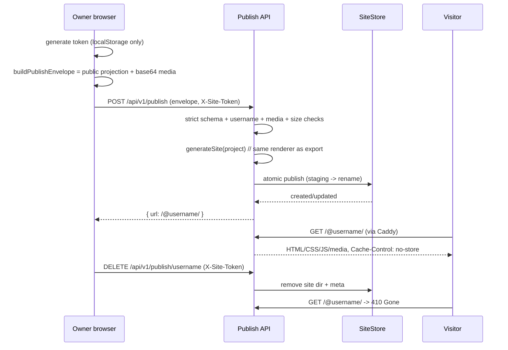

# Architecture

## System diagram

```mermaid
flowchart TB
    subgraph owner[Owner's phone]
      UI[Editor PWA<br/>Preact + TS<br/>src/editor]
      LS[(localStorage<br/>site token)]
      IDB[(IndexedDB<br/>private data)]
      UI --- LS
      UI --- IDB
    end

    subgraph core[Shared pure core — src/core]
      GEN[generateSite<br/>single renderer]
      PROJ[publicProjection<br/>privacy filter]
      SCHEMA[zod schemas<br/>validation]
      ZIP[export/import ZIP]
    end

    UI -->|build envelope| PROJ
    PROJ --> GEN
    UI -->|download| ZIP

    subgraph edge[Deployment]
      CADDY[Caddy<br/>static editor + reverse proxy]
      API[Publish service<br/>node:http + server/]
      FS[(data/sites<br/>data/meta)]
      CADDY -->|/@*, /api/*| API
      API --> FS
    end

    CADDY -->|dist/ static| UI
    GEN -->|same output| API
    VIS[Visitor browser] -->|/@username/| CADDY
```

## Publish data flow



## Trust boundaries

1. Owner input (typed text, picked files) → validated by zod before it enters the
   core model.
2. Imported ZIP / `site.json` → parsed with path, size and cross-reference checks
   (`src/core/zip.ts`).
3. Publish envelope (JSON from the network) → strict schema, media allow-list and
   byte caps (`src/core/publish.ts`) before reaching the generator.
4. Generated output → escaped HTML/XML, safe JSON-in-script, strict CSP, relative
   URLs, fixed safe filenames.
5. Owner credential → salted hash at rest, header-only in transit, never in a
   generated file or log.
