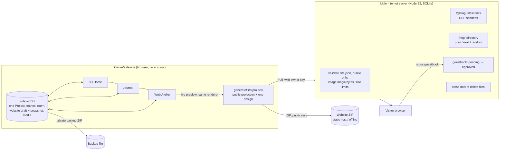

# Architecture

## Rules that hold the design together
1. **One data source.** The Project holds entries, recordings, keepsakes, room and the website design. Widgets store
   ids, never copies of diary text.
2. **Draft vs published.** `web.draft` is edited; `web.published` is a frozen copy. `publicProjection(p)` keeps exactly one
   design (the snapshot), drops hidden widgets and private references, and ships only the media a public entry, that
   design or a friend badge uses.
3. **One renderer.** `generateSite` builds publishing, export and (inlined, no scripts) the Atelier preview.
4. **Server trusts nothing.** It re-validates the uploaded `site.json`, refuses private entries and non-images, and
   serves pages in a sandbox with no access to the editor origin. Owner keys are stored as SHA-256 hashes only.
5. **Privacy follows content.** When something stops being public the editor republishes; Close the Door deletes the
   published copy. The service worker never caches the API, published sites or the webring.
6. **Portable.** Website ZIP runs on any static host; the private backup restores everything including the design.
